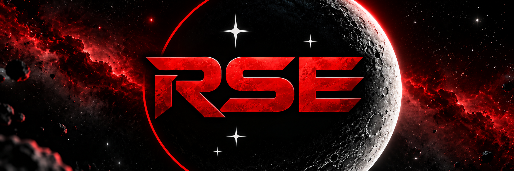

  

<h1 align="center">Reality Software Entertainment</h1>

  <em>An independent studio making short, strange, replayable games, and the tools we wished we had while making them.</em>

  <a href="https://www.ravensight.io"><strong>ravensight.io</strong></a> ·
  <a href="https://www.realityse.com">realityse.com</a> ·
  <a href="https://www.realityse.com/games">Games</a> ·
  <a href="https://www.realityse.com/press/kits">Press kits</a>

---

## Our games

We ship small games with sharp ideas on **iOS, Android, Steam, the web and itch.io**:
roguelikes you can finish in a lunch break, trivia for people who actually know the
subject, dice and card games, and folk horror with a mean streak.

Every title, with store links, lives at **[realityse.com/games](https://www.realityse.com/games)**.

---

## Ravensight

**[Ravensight](https://www.ravensight.io)** connects the whole life of your game:
brainstorms, design, playtesting, player behavior, marketing and sales. We built it
for our own games first, so every release could make the next one smarter.

- **Start with your idea.** Brainstorm with an AI partner, develop design documents
  and bring your studio’s existing knowledge into the work. Your vision stays at
  the center.
- **Understand what players actually do.** Explore events, retention, funnels,
  journeys and live activity. Investigate changes with alerts, reports and
  experiments, and share findings with the people making the game.
- **Ask Huginn. Remember with Muninn.** An AI analyst answers questions using your
  data and shows the evidence. Studio memory connects documents, findings and
  decisions across your games, so the next project doesn’t start from scratch.
- **Test, investigate and improve.** AI personas play your build, while Simulation
  Runner exercises repeatable scenarios. Player Reports bring feedback and
  submitted screenshots into the investigation. Playtests currently run on your
  own machine; **hosted playtesting is planned** so you can run builds in the cloud.
- **Learn from the whole release.** Bring marketing attribution and storefront
  sales together with player behavior, then carry what worked into your next game.
- **Work with your tools.** Engine SDKs, MCP and focused agent skills connect
  Ravensight to your game and coding workflow, from integration checks to analysis.

**Unlimited games and teammates, with shared usage.** Every studio gets one million
included events and ten AI units each month, with no card required. Additional
usage, playtests and source scans use a prepaid balance.

**[Explore Ravensight](https://www.ravensight.io/build-better-games/)** ·
[Start free](https://app.ravensight.io/signup) ·
[Docs](https://www.ravensight.io/docs/) ·
[Blog](https://www.ravensight.io/blog/)

## Open-source skill telemetry

**[Ravensight Skill Telemetry](https://github.com/Reality-Software-Entertainment/ravensight-skill-telemetry)**
is our Apache-2.0 Rust foundation for understanding agent skill activity. Three small
components provide a local telemetry journal, a Claude Code hook adapter and
read-only skill discovery. No Ravensight account is required.

It records skill activity and explicitly reported outcomes without retaining prompts,
source code or tool responses. Loading a skill does not count as completing its work.
Exports support normalized JSONL and OpenTelemetry JSON, with no built-in network
transport. The source is available now; package releases and broader live-client
compatibility verification are still pending.

---

  <a href="https://www.realityse.com/press/kits">Press and media</a> ·
  <a href="https://www.realityse.com">Get in touch</a>

